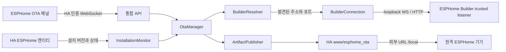

# ESPHome OTA 컴포넌트 이식 설계

작성일: 2026-10-09. 상태: 구현 전 설계. 도메인: `esphome_ota`.

이 문서는 `hassio-apps/docs/esphome-ota-integration-design.ko.md`에서 인계용으로 복사했으며, 대상 경로는 `/Users/eigger/Documents/GitHub/hass-esphome-ota`로 확정했다. 실행 범위와 검증 순서는 `WORK_ORDER.md`를 따른다.

## 1. 목표와 완료 기준

목표는 ESPHome Builder 애드온을 자동으로 찾아 **공개 포트 설정과 별도 인증 입력 없이 빌드·게시**하는 Home Assistant 커스텀 통합이다. `ble-esl`의 ESL Manager처럼 HA 사이드바에서 관리하며, 사용자에게 등록·버전 입력·YAML 복사·바이너리 다운로드를 반복시키지 않는다.

기본 지원 환경은 HA OS의 ESPHome Device Builder 애드온이다. 다른 실행 환경은 같은 loopback 조건을 충족하는지 별도 확인한다. 외부 Builder와 사용자 토큰 입력은 초기 제품 범위에 포함하지 않는다.

첫 번째 완료 기준은 실제 HA 프로세스에서 `공개 포트 미설정 + leave_front_door_open 비활성 + dashboard_token 없음` 상태로 기기 목록 조회, 빌드, 결과 확인, 바이너리 다운로드가 모두 성공하는 것이다. 이 검증에 실패하면 패널 구현으로 넘어가지 않고 연결 방식을 먼저 해결한다.

자동화할 것은 연결·목록 동기화·작업 진행·게시·복구다. 기기 검색만으로 사용자 YAML을 수정하거나 빌드를 시작하지 않는다. YAML 적용과 빌드·게시는 사용자가 해당 동작을 선택하면 진행한다.

## 2. 연결 방식의 근거와 경계

Builder의 trusted Ingress listener는 loopback과 Supervisor에서 들어오는 연결을 허용한다. HA Core의 ESPHome 통합도 loopback 접근을 사용하는 것이 의도된 구조다. trusted listener에는 `/ws`와 펌웨어 HTTP 다운로드가 등록되어 있으며, WebSocket 연결은 별도 로그인 없이 명령을 실행할 수 있다.

커스텀 통합의 Python 코드가 이 listener에 접속한다. 브라우저의 `127.0.0.1`은 사용자 컴퓨터이므로 프런트엔드가 Builder에 직접 연결하지 않는다. 기존 OTA 애드온의 gateway 주소나 공개 포트 탐색 코드를 그대로 사용하지 않는다.



빌드 서버 로그인 토큰은 사용자에게 요구하지 않는다. 다운로드 API가 발급하는 일회용 토큰은 프로토콜 내부에서 자동 처리한다. 기존 기기의 공개 URL에 들어간 OTA 토큰과는 다른 개념이다.

코드·문서 검토로 연결 설계의 근거를 확인했지만, 이 문서 작성 시 실제 HA에서 연결한 결과는 없다. 지원할 HA와 Builder 최소 버전은 1단계 실증 후 명시한다.

## 3. 사용자 흐름

### 설치와 연결

1. 통합 추가 화면은 자동 탐색부터 실행한다. URL·포트·토큰 입력 폼을 기본 화면에 두지 않는다.
2. 실행 중인 Builder가 하나면 검증 후 선택한다. 여러 개면 이름·안정/개발 채널·연결 상태를 보여주고 한 번 선택하게 한다.
3. HA 외부 URL이 있으면 게시 주소로 제안한다. 없으면 원격 기기가 접근할 URL만 입력한다. 이 값은 기기 다운로드 주소이며 Builder 연결 주소와 별개다.
4. 사이드바에 ESPHome OTA를 표시하고 Builder의 기기를 바로 목록에 보여준다.

Builder가 꺼져 있거나 HA 시작 순서 때문에 아직 발견되지 않았으면 `Builder 시작 대기`를 표시하고 재탐색한다. 이미 설정된 통합과 게시 파일은 유지한다. 게시 주소가 없어도 연결·목록 조회는 가능하게 하고 게시 동작만 이유와 함께 비활성화한다. 원격용 주소를 LAN IP로 조용히 대체하지 않는다.

### 기기 준비와 첫 설치

- 별도 기기 등록 폼을 없앤다. Builder 기기 카드에서 `OTA 준비`를 선택한다.
- 준비 화면은 추가할 OTA 설정과 버전 정책을 보여준다. 기본은 HTTP Update 엔티티, 버튼은 고급 대안이다.
- 기본 버튼 `설정 적용 후 빌드·게시`는 YAML 수정, 검증, 빌드, 바이너리 확인, 게시를 이어서 수행한다.
- 게시 후에도 기존 기기 펌웨어에 HTTP OTA 기능이 없으면 `첫 설치 필요` 상태를 유지한다. 기존 OTA나 USB를 통한 최초 설치가 필요하며, 링크된 Builder 화면으로 안내한다.
- HTTP OTA를 이미 가진 기기는 `빌드·게시`가 기본 동작이다. 게시와 설치를 별도 단계로 표시한다.
- HA에서 기기의 Update 엔티티를 찾은 경우 `업데이트 설치`를 제공한다. 자동 게시 자체로 설치를 시작하지 않는다. 첫 설치의 직접 플래시는 초기 범위에서 Builder에 맡긴다.

이미 배포된 기기에 새 토큰이나 HTTP OTA 설정을 넣는 것은 YAML 변경만으로 완료되지 않는다. 기존에 사용할 수 있는 설치 경로가 없는 원격 기기는 이 패널만으로 부트스트랩할 수 없다.

### 패널 구성

`ble-esl`의 `manager.js`처럼 HA 테마·언어·메뉴 버튼을 받는 custom element를 사용한다. OTA 특성상 기기별 상태와 여러 기기 선택이 중요하므로, 목록 행을 기본으로 하고 작은 화면에서는 카드로 표시한다.

- 상단: Builder 연결 상태, 선택된 Builder 이름, 재연결, Builder 열기.
- 목록: 기기명, YAML 이름, OTA 준비 상태, 설치 버전, 게시 버전, 최신 작업 단계, 기본 동작.
- 필터: 전체 / 준비 필요 / 첫 설치 필요 / 업데이트 가능 / 작업 중 / 실패.
- 상세: 작업 로그, 릴리스 노트, YAML 변경 내역, Update 엔티티 연결, 게시 이력, 재게시·숨김·설정 제거.
- 일괄 작업: 선택한 기기의 빌드·게시와 결과 요약. 한 기기의 실패는 나머지 작업을 중단하지 않는다.
- 수동 업로드는 상세 메뉴의 복구 수단으로 유지한다.

연결 상태, 빌드·게시 상태, 실제 기기 설치 상태를 하나의 성공 표시로 합치지 않는다. 기기가 오프라인이면 설치 버전은 `확인 불가`로 표시한다.

## 4. 자동 연결과 복구

### 후보 탐색

`BuilderResolver`는 다음 순서로 후보를 수집한다.

1. HA ESPHome 통합이 이미 발견한 dashboard URL과 addon slug.
2. HA의 Supervisor client를 통한 ESPHome 서비스 discovery 정보.
3. discovery 정보가 부족할 때만 선택한 애드온의 현재 Ingress 정보를 조회하여 loopback 후보를 구성한다.

HA의 `esphome.dashboard`와 `hassio` Python 인터페이스는 버전 변경 위험이 있으므로 `builder/ha_discovery.py`에 격리한다. 지원할 HA 버전의 실제 반환 구조를 테스트하고, 다른 모듈이 `hass.data` 내부 키에 직접 의존하지 않게 한다. Supervisor 접근에는 HA가 관리하는 client를 사용하며 애드온 전용 `SUPERVISOR_TOKEN` 환경변수에 의존하지 않는다.

`6052` 또는 특정 Ingress 포트를 하드코딩하지 않는다. handshake의 `port`는 공개 포트일 수 있으므로 trusted listener 주소로 사용하지 않는다. `/api/hassio_ingress/<세션>`도 서버 간 기본 접속 주소로 사용하지 않는다.

선택 우선순위는 저장된 선택 → HA가 현재 사용하는 Builder → 유일한 실행 후보다. 후보가 여러 개이고 선택 정보가 없으면 사용자에게 선택을 받는다. 연결 장애 때 다른 Builder로 자동 전환하지 않는다.

### 후보 검증과 capability

발견된 주소가 loopback 경로인지 확인하고 `/ws` handshake와 읽기 전용 목록 조회로 검증한다. `ha_ingress`는 프록시 헤더가 있을 때만 true일 수 있으므로 직접 loopback 접속의 필수 조건으로 사용하지 않는다.

`requires_auth=true`, peer guard 403, 잘못된 API, 지원하지 않는 버전은 서로 다른 오류로 분류한다. 자동 연결 오류를 공개 포트를 열라는 안내로 바꾸지 않는다.

capability는 최소 지원 버전과 읽기 전용 probe 결과로 결정한다. 쓰기 명령을 탐색용으로 실행하지 않는다. `config_write_cas`, `validate`, `compile`, `follow_job`, `get_job`, `download`, `cancel`, `events`를 구분하고 없는 기능은 UI에서 제한한다. YAML CAS 지원을 확인하지 못하면 자동 YAML 변경은 제공하지 않는다.

상태는 `discovering → connecting → ready`이며 장애 시 `reconnecting`, 애드온 정지 시 `waiting`, 선택 미완료 시 `selection_required`, 호환성 문제 시 `unsupported`로 전환한다.

- 연결 실패 시 기존 WS reader를 정리하고 2/5/10/30/60초 상한의 backoff와 jitter로 재탐색한다.
- 애드온 재시작으로 포트가 바뀌면 저장된 slug를 기준으로 주소를 다시 찾는다. URL은 재검증 전까지 hint다.
- 재연결 후 기기 목록과 추적 중인 Builder 작업 상태를 동기화한다.
- HA 공유 HTTP session은 통합이 닫지 않는다. WS와 reader·subscription은 통합이 소유하고 정리한다.
- UI가 닫혀도 작업은 계속된다. reload 때는 추적만 중단하고 Builder 작업을 자동 취소하지 않는다. 사용자 취소는 별도 API로 요청하고 최종 상태까지 확인한다.

## 5. 모듈과 책임

```text
custom_components/esphome_ota/
  __init__.py                 # entry setup/unload, runtime_data
  manifest.json              # HA 의존성, config_flow, 버전
  config_flow.py             # 자동 발견, Builder 선택, 게시 주소
  const.py / models.py       # 상태·DTO·오류
  manager.py                 # 사용 사례 조합; 파일/WS 직접 구현 금지
  builder/
    ha_discovery.py           # HA ESPHome/Supervisor 접점 격리
    resolver.py               # 후보·선택·현재 endpoint
    connection.py             # WS multiplex, reconnect, command/stream
    client.py                 # 기기·YAML·빌드·artifact API
    capabilities.py           # 지원 범위·API 호환성
  devices.py                 # Builder 목록과 관리 상태 결합
  config_patch.py            # OTA 설정 diff, 버전 소유권, CAS
  packages.py                # OTA YAML 생성; 문자열/데이터 반환
  jobs.py                    # 파이프라인·취소·중복 방지·복구
  firmware.py                # 바이너리 검사·버전·MD5/SHA256
  publisher.py               # private artifact, 원자적 공개 게시
  monitor.py                 # HA Update 상태 연결·만료 처리
  storage.py                 # Store, schema migration, 작업 checkpoint
  migration.py               # 애드온 데이터 가져오기
  panel.py / websocket.py    # 패널·관리자 명령·구독
  http.py                    # 관리자 multipart 업로드
  diagnostics.py             # 토큰·YAML·자격정보를 제외한 진단
  strings.json / translations/
  frontend/
    manager.js / device-dialog.js / job-dialog.js / i18n.js
tests/components/esphome_ota/
```

단일 config entry가 하나의 Builder와 여러 OTA 기기를 관리한다. 1차 버전은 singleton entry다. 다른 Builder를 발견해도 설정 선택을 변경하기 전에는 데이터를 합치지 않는다.

패널·관리 API는 도메인 단위로 한 번 등록한다. 패널은 entry 로드 상태에 맞춰 추가·제거하고, 등록된 API는 unload 상태에서 정해진 오류를 반환한다. reload마다 정적 route나 WS command를 중복 등록하지 않는다. executor 작업이 완료된 뒤 이전 runtime을 변경하지 못하도록 generation 검사를 둔다.

## 6. 데이터 모델과 저장 경로

| 모델 | 핵심 필드 / 역할 |
|---|---|
| BuilderSelection | 선택 slug/identity, 탐색 방식, 마지막 endpoint hint. 현재 연결 상태는 runtime |
| ManagedDevice | 안정적인 내부 ID, configuration, name, friendly_name, URL slug/token, YAML 적용 방식, version policy, HA entity 연결, 만료 정책 |
| PipelineJob | 내부 job_id, device_id, Builder identity/job_id, 요청 ID, stage, 예약 버전, YAML hash, artifact hash, checkpoint, 오류 |
| PublishedArtifact | device_id, version, chip, size, MD5/SHA256, 빌드·게시 시각, private 위치, 공개 상태 |

Builder의 `configuration`(YAML 파일명)과 ESPHome `name`을 구분한다. 자동 연결되는 기기와 OTA 관리에 참여한 기기도 구분한다. 관리 참여 전에는 토큰·래퍼·등록 데이터를 만들지 않는다.

설정 변경과 이름 변경을 발견해도 공개 slug는 자동 변경하지 않는다. rename을 확실히 연결할 수 없으면 기존 관리 기기를 `YAML 찾을 수 없음`으로 표시하고 사용자에게 재연결을 제공한다. 파일 목록에서 사라졌다는 이유로 펌웨어와 이력을 삭제하지 않는다.

- config entry: Builder 선택, 게시 base URL, 기본 만료 정책.
- HA `Store`: `esphome_ota.devices`, `esphome_ota.jobs`, `esphome_ota.artifacts`, `esphome_ota.migration`.
- private binary: `hass.config.path("esphome_ota", "firmware", <device_id>, <sha256>)`.
- 공개 파일: 기존 `hass.config.path("www", "esphome_ota")`와 slug를 유지.
- YAML과 secrets는 Store·진단·일반 로그에 저장하지 않는다. 복구용 YAML 원본이 필요한 작업은 관리 API에서만 접근 가능한 private backup 파일로 제한한다.

버전이 있는 Store schema를 사용한다. 파일 접근·해시·바이너리 분석·공개 게시 전체는 executor에서 실행하고, runtime 데이터 반영과 이벤트 발행은 HA loop에서 한다. 같은 기기의 설정 수정·게시·숨김은 하나의 lock으로 직렬화한다.

## 7. YAML 준비와 버전 정책

Builder가 기기 목록과 소스의 기준이다. 목록을 `/config/esphome` 스캔으로 대체하지 않는다. YAML은 `devices/get_config`로 읽고 `devices/update_config`의 `expected`로 경쟁 편집을 확인한 뒤 수정한다.

새 기기는 `packages.esphome_ota`라는 관리 package에 필요한 설정을 담는 방식을 우선한다. 같은 장치 YAML에 넣는 방식으로 다른 파일 생성과 공유 디렉터리 가정을 줄인다. 기존 `ota_server/...` include를 쓰는 기기는 호환 경로로 인식하고 기존 동작을 유지한다. 새 package의 ESPHome 병합·버전 소유권 동작은 컴파일 검증 후 확정한다.

설정 변경은 `읽기 → 변경 계획/diff → 충돌 검사 → CAS 저장 → Builder 검증` 순서다. 사용자 `packages.ota`, project, OTA 비밀번호 등을 임의로 덮어쓰지 않는다. `!include`, `!secret`, 주석과 기존 package를 보존한다. 지원하지 않는 YAML 구조나 포함 파일의 project 소유권이 불분명하면 수동 검토로 전환한다.

자동 rollback은 현재 YAML이 이 작업이 저장한 값과 일치할 때만 CAS로 수행한다. 다른 편집이 들어왔으면 복구 내용을 제시하고 중단한다. 설정 제거도 통합이 소유한 block만 대상으로 하며, 기기의 실제 기능 제거에는 새 펌웨어 설치가 필요하다.

기본 버전 정책은 다음과 같다.

- 사용자 또는 외부 package가 project version을 소유하면 그대로 사용한다. 변경은 사용자가 관리한다.
- 통합이 소유한 기기는 최초 `1.0.0`, 새 빌드 작업에서 patch를 증가시킨다. 동일 요청 재시도는 예약 버전을 재사용한다.
- 빌드 성공과 게시 성공의 버전을 따로 기록한다. 게시 실패 후 재게시만으로 버전을 다시 올리지 않는다.
- 실제 게시 버전은 바이너리에서 확인한 값이 우선이다. 예약 버전과 다르면 자동 게시를 중단하고 설명한다.
- 버전을 확정할 수 없는 바이너리는 자동 성공으로 처리하지 않고, 사용자 지정 버전 또는 별도 force-button 흐름이 필요함을 표시한다.

## 8. 빌드·게시 파이프라인

```text
preparing → validating → submitting → queued → building
          → downloading → verifying → publishing → published
                                                     ↓
                             installing → installed / install_failed

각 단계: failed / cancelling / cancelled / recovery_required
```

`published`가 빌드·게시 작업의 성공이다. 설치는 별도 사용자 동작과 상태다. Builder `firmware/install`은 기기에 직접 upload하는 동작이므로 원격 HTTP OTA의 기본 빌드에 사용하지 않는다. 빌드는 `firmware/compile`을 사용한다.

`JobRunner`의 순서:

1. 요청 ID로 중복 제출을 막고 기기 lock 획득, 연결·URL·OTA 설정·지원 칩 검사.
2. 필요한 설정 적용과 버전 예약, Builder 검증.
3. compile 제출 후 반환된 Builder job_id를 즉시 checkpoint에 저장.
4. 해당 job의 명시적인 완료를 확인하고 artifact 목록에서 OTA 타입을 선택.
5. 일회용 다운로드 토큰 발급, HTTP로 private 임시 파일에 내려받기.
6. 크기·칩·버전·바이너리 구조·해시 검사 후 private artifact 확정.
7. 공개 `.bin`·MD5를 먼저 준비하고 manifest를 마지막에 게시, 이력 저장.
8. 기존 Update 엔티티 새로고침을 지원하면 요청하고, 설치 상태와 만료 정책 감시.

결과 상태가 unknown이거나 stream 종료만 관찰된 경우 성공으로 간주하지 않는다. `get_job`으로 재확인한다. 현재 `DashboardClient.compile()`의 unknown 허용 동작은 이식 때 제거한다.

Builder가 compile queue를 소유한다. 통합은 한 번에 제한된 수의 pipeline을 진행하고 기기별 중복만 막는다. Builder queue 순서를 UI에 보여주며 별도의 무한 로컬 queue를 만들지 않는다. 초기값은 하나의 publish pipeline을 진행하고 일괄 요청을 순서대로 넘기는 방식이다.

Builder API의 artifact 선택은 configuration 기반이므로 외부 Builder 화면에서 같은 기기를 다시 빌드하면 결과 파일이 바뀔 수 있다. 다운로드 전후 같은 configuration의 작업과 YAML 상태를 확인하고 후속 빌드·내용 변경·버전 불일치가 감지되면 자동 게시를 중단한다. 이것은 immutable job artifact API와 같은 완전한 보장은 아니다. 정확한 job-artifact 귀속을 보장할 upstream API가 있는지는 실증 단계에서 확인하고, 보장할 수 없는 경쟁 상황은 복구 필요 상태로 처리한다.

네트워크 실패는 읽기·재연결·새 다운로드 토큰 발급만 자동 재시도한다. 응답을 받기 전에 연결이 끊긴 compile 제출은 중복 빌드를 바로 만들지 않는다. 저장된 checkpoint와 Builder jobs를 대조해 확실히 연결할 수 없으면 `작업 제출 여부 확인 필요`로 표시한다.

HA 재시작 후에는 알려진 job_id를 조회하여 추적을 재개한다. 이미 검증된 private artifact의 게시 재시도는 빌드 없이 가능하다. Builder가 job을 보관하지 않으면 기존 공개 펌웨어는 유지하고 해당 작업을 복구 필요로 표시한다.

## 9. 게시와 설치 감시

기존 `/local/esphome_ota/<slug>.json` 계약을 유지하여 기존 기기 URL을 깨뜨리지 않는다. MD5와 cache-buster 정책도 유지한다. 새 Store에는 SHA256을 추가해 private artifact를 구분한다.

파일 단위 원자적 replace와 manifest-last 순서만으로 여러 파일의 원자적 교체가 보장되지는 않는다. 기존 manifest를 읽은 기기가 새로운 binary를 받는 짧은 구간에는 MD5 재시도 오류가 날 수 있다. 신규 HTTP Update 기기의 manifest는 content hash를 포함한 immutable binary 경로를 가리키도록 설계한다. 기존 button이 사용하는 고정 binary/MD5 URL은 호환 alias로 유지하고 이 경쟁 조건을 숨기지 않는다.

public 파일 제거는 이미 진행 중인 다운로드나 앞단 캐시를 취소하는 동작이 아니다. 숨김은 공개 원본에서 binary를 제거하며 private artifact와 기존 manifest는 보존한다. 기존 토큰은 URL의 추측을 어렵게 하는 값으로 취급하고 HA 로그인 인증과 동일시하지 않는다.

`InstallationMonitor`는 HA entity/device/config-entry registry와 `hass.states`를 사용한다. entity_id 문자열을 이름에서 추측한 결과만으로 자동 설치·숨김하지 않는다. 소스 URL/registry 연결 등의 근거로 확실히 매칭하거나 사용자가 한 번 선택하도록 한다. 엔티티 rename과 삭제를 처리한다.

설치 성공은 매칭된 기기의 최신 installed_version이 게시 버전과 같고 in_progress가 false일 때 기록한다. 동일 버전 재게시만으로 새 바이너리 설치를 증명할 수 없으므로 그 경우 성공 기반 자동 숨김을 사용하지 않고 타이머 또는 명시적 설치 결과를 요구한다. 상태 unavailable은 성공으로 취급하지 않는다.

초기 기본 만료는 기존 12시간을 유지하며, 신뢰 가능한 상태 연결이 있는 경우 성공 시 숨김을 함께 사용한다. expiry는 재시작 시 복구한다. Update 엔티티가 없는 기기는 게시 기능을 유지하되 설치 상태를 확인 불가로 표시한다. 동일 펌웨어의 HA Update 엔티티를 별도로 추가 생성하지 않는다.

## 10. HA API와 프런트엔드

- 관리자 WS 명령: 연결 상태/재탐색, 목록/상세, OTA 변경 계획/적용, 빌드·게시, 취소, 재게시/숨김, HA 엔티티 연결, 이전 데이터 가져오기.
- subscription: 초기 snapshot + 기기 변경 + 연결 변경 + job 진행 이벤트. sequence와 bounded log tail을 포함하고 재구독 시 복구한다.
- 패널을 닫으면 subscription만 해제한다. 페이지 로드마다 전체 목록을 매초 polling하지 않는다.
- 빌드 요청은 job_id를 즉시 반환한다. 완료까지 HA WS 응답을 잡고 있지 않는다.
- 수동 업로드는 관리자 HTTP View의 multipart로 받는다. binary를 base64 WS 메시지에 넣지 않는다. 크기 제한과 HTTP/프록시 제한을 포함해 실제 지원 크기를 검증한다.
- UI에 raw YAML·공개 토큰 URL·전체 빌드 로그를 상시 노출하지 않는다. 상세 확인과 복사 동작에서만 필요한 내용을 제공한다.
- 외부 입력은 schema·configuration 경계·path traversal을 검증한다. 사용자 지정 URL 접근은 관리자 설정에만 한정한다.

## 11. 기존 애드온 코드와 데이터 이전

| 현재 파일 | 처리 |
|---|---|
| `main.py`, services run, Dockerfile | 새 통합 실행에는 사용하지 않음. 기존 애드온 배포는 유지 |
| `server.py` App/route | manager/jobs/devices/websocket/http로 책임 분리 |
| `dashboard.py` | command/stream 의미 재사용, session 주입·reader 종료·재연결·job 복구 보강 |
| `metadata.py` | 바이너리·텍스트/YAML 분석을 순수 로직으로 분리. 파일 scan은 legacy migration으로 제한 |
| `packages.py` | 생성 로직 재사용. 생성과 파일 쓰기 분리, 새 inline 관리 package 추가 |
| `publisher.py` | 원자적 파일 처리 재사용. private 경로 주입·immutable artifact·저장 오류 처리 보강 |
| `registry.py` | HA Store와 버전 migration으로 교체 |
| `supervisor.py` | HA discovery adapter와 state/registry 접근으로 대체 |
| `static/index.html` | 기능·번역 재사용, custom panel과 WS subscription으로 재구성 |

이전 순서:

1. `esphome/ota_server/registered.json`, 래퍼, 공개 manifest를 읽기 전용으로 검사하고 가져올 기기·파일 요약 생성.
2. 토큰, slug, version 소유권, base URL, 선택한 HA entity, expiry를 보존하며 Store로 변환.
3. 공개 binary가 있으면 private 저장소에 복사하고 해시 검증. 애드온 `/data/firmware`의 숨긴 binary는 애드온 export 기능을 통해 이전한다. 통합에서 직접 읽을 수 있다고 가정하지 않는다.
4. 애드온을 중지한 뒤 최종 재검사와 가져오기를 실행한다. 같은 registry·www에 두 writer를 동시에 두지 않는다.
5. 가져오기 결과와 재연결을 확인한다. 기존 파일은 migration 성공 뒤에도 자동 삭제하지 않는다.

구현 위치는 `/Users/eigger/Documents/GitHub/hass-esphome-ota`이며 HACS용 커스텀 통합 저장소로 구성한다. 원본 `hassio-apps`는 참조하고 변경하지 않는다. 원격 저장소 생성·게시와 기존 애드온 종료는 구현 작업의 자동 수행 범위에 포함하지 않는다. 상세 작업 범위는 상위 디렉터리의 `WORK_ORDER.md`를 따른다.

## 12. 구현 순서와 검증

| 단계 | 결과물 | 통과 기준 |
|---|---|---|
| 1. 연결 실증 | HA entry + discovery adapter + 최소 Builder client | token/공개 포트 없이 list→compile→확정 성공→download, Builder 재시작 후 재탐색 |
| 2. 작업·게시 | checkpoints, artifact validation, Store, publisher | 중복·실패·재시작에서 잘못된 성공/재빌드 없이 기존 게시본 보존 |
| 3. OTA 준비 | YAML diff/CAS, 버전 정책, 초기 설치 상태 | 기존 secrets/include/project 보존, 경쟁 편집 감지, 최초 설치 필요 구분 |
| 4. 편의 패널 | ESL Manager 방식 패널, subscription, batch | 등록 없이 기기 목록, 한 흐름의 빌드·게시, reconnect·cancel·retry 표시 |
| 5. 이전·배포 | migration/export, HACS 메타데이터, 지원 버전 문서 | 기존 토큰/URL 유지, 숨긴 artifact 이전, reload/unload 정리 |

중점 테스트는 실제 위험과 상태 전이에 둔다.

- discovery 지연/복수 후보/포트 변경/403/인증 요구/unsupported 구분.
- trusted WS 접속에서 `ha_ingress=false`여도 정상 동작.
- stream 종료·unknown 상태·실패 빌드에서 게시 금지.
- compile 응답 유실과 재시작에서 중복 제출 방지.
- YAML CAS 충돌·기존 package key·사용자 project 소유권·rollback 충돌.
- 바이너리 칩/버전 불일치, 외부 동시 빌드, 다운로드 토큰 만료 재발급.
- 게시 중단/저장 실패/동일 버전 재게시/만료 복구/Update unavailable.
- 관리자 권한과 upload 한계, reload 중복 등록과 task/subscription 누수.
- 기존 버전 소유권·토큰·빌드 시각 테스트를 이식한 뒤 실제 ESPHome compile smoke test.

실환경 수용 테스트의 대표 흐름은 `통합 추가 → 자동 연결 → 기기 선택 → OTA 준비와 diff → 빌드·게시 → 필요 시 최초 설치 → 다음 버전 빌드·게시 → HTTP Update 설치 확인`이다. Builder를 재시작하고 HA 패널을 다시 열어도 수동 URL/토큰 재입력이 없어야 한다.

## 근거

- [Builder 인증 구조](https://github.com/esphome/device-builder/blob/main/docs/ARCHITECTURE.md#authentication)
- [trusted listener와 API 등록](https://github.com/esphome/device-builder/blob/main/esphome_device_builder/device_builder.py)
- [WebSocket handshake](https://github.com/esphome/device-builder/blob/main/esphome_device_builder/api/ws.py)
- [Builder API 계약](https://github.com/esphome/device-builder/blob/main/docs/API.md)
- [다운로드 토큰 처리](https://github.com/esphome/device-builder/blob/main/esphome_device_builder/controllers/firmware/download.py)
- [Builder 작업 조회·취소](https://github.com/esphome/device-builder/blob/main/esphome_device_builder/controllers/firmware/jobs.py)
- [HA ESPHome 대시보드 발견 정보](https://github.com/home-assistant/core/blob/dev/homeassistant/components/esphome/dashboard.py)
- [HA의 blocking 작업 지침](https://developers.home-assistant.io/docs/asyncio_blocking_operations/)
- 로컬 참조: `hass-ble-esl/custom_components/ble_esl/designer/__init__.py`, `frontend/manager.js` 및 현재 `esphome_ota` 구현.
